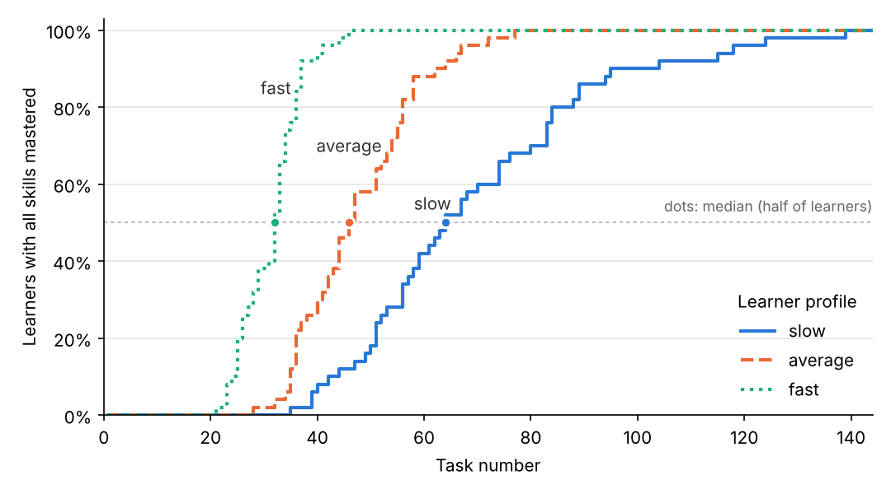

# ct-adaptive-engine

[](https://github.com/USERNAME/ct-adaptive-engine/actions/workflows/ci.yml)


The adaptive core of a learning game that develops critical thinking in
schoolchildren aged 11–14. It is the software module of the master's thesis
*“A personalized learning game environment using AI and gamification to develop
critical thinking in schoolchildren”* (Astana IT University).

The engine answers one question after every task: **what should this learner do
next?** It does so in two layers:

| Layer | What it does | Module |
|---|---|---|
| **Estimation** | Bayesian Knowledge Tracing (BKT) keeps, for each skill, the probability that the learner has mastered it | `ct_adaptive.bkt` |
| **Decision** | Nine transparent rules turn those probabilities into the next skill, difficulty level and hint | `ct_adaptive.rules` |
| **Simulation** | Synthetic learners run through the engine, so its behaviour can be studied before classroom data exist | `ct_adaptive.simulation` |

No model training, no GPU and no runtime dependencies: the whole engine is
closed-form arithmetic in pure Python.

## Installation

Python 3.10 or newer is required.

```bash
git clone https://github.com/USERNAME/ct-adaptive-engine.git
cd ct-adaptive-engine
pip install -e ".[dev]"     # engine + tests + plotting
```

Only the engine, with no extra packages: `pip install .`

## Quick start

### Use the engine in code

```python
from ct_adaptive.rules import AdaptiveEngine

engine = AdaptiveEngine(skills=["analysis", "evaluation", "inference"])

decision = engine.next_task()
print(decision)
# Decision(skill='analysis', difficulty=1, hint=False, review=False, rules=('R1.1', 'R2.1'))

engine.record(decision, correct=True)
print(engine.mastery())
# {'analysis': 0.5, 'evaluation': 0.1, 'inference': 0.1}
```

Every `Decision` lists the rules that produced it, and `engine.history` keeps a
full log of the session, so each adaptation step can be explained.

### Run the simulation study

```bash
ct-simulate --learners 50 --max-steps 150 --seed 42 --out results
```

```
profile     completion   median tasks  false mastery
slow              100%           64.0           3.7%
average           100%           46.5           1.3%
fast              100%           32.0           0.3%
```

Output files in `results/`:

| File | Content |
|---|---|
| `interactions.csv` | every simulated task: skill, difficulty, answer, P(L) before/after, rules fired |
| `learners.csv` | one row per synthetic learner |
| `summary.csv` | one row per learner profile (the table above) |
| `metadata.json` | seed, all parameters, package and Python versions |
| `completion.png` | share of learners with all six skills mastered, by task number |



**How to read it.** With the literature-based parameters, a *slow* learner needs
a median of 64 tasks to reach the mastery threshold on all six skills, a *fast*
learner 32. In 3.7 % of cases for slow learners the engine declared a skill
mastered that the synthetic learner had not truly mastered. This is the cost of
uncalibrated parameters, and rule R1.3 (spaced review) exists to catch it.
These are simulation results, not claims about real children; the pilot study
in the thesis will check them.

## The model

Full formulas and rules: [`docs/model.md`](docs/model.md).

| Parameter | Value | Meaning |
|---|---|---|
| P(L0) | 0.10 | prior probability the skill is already mastered |
| P(T) | 0.25 | probability of learning on one task |
| P(S) | 0.10 | slip: wrong answer despite mastery |
| P(G) | 0.20 | guess: right answer without mastery |
| threshold | 0.95 | mastery criterion (Corbett & Anderson, 1995) |

Rules: **R1.1** weakest skill first · **R1.2** at most 3 tasks in a row on one
skill · **R1.3** review of a mastered skill every 15 tasks · **R2.1–R2.3**
difficulty by mastery zone (< 0.40 / < 0.70 / ≥ 0.70) · **R3.1** two errors → one
level down + hint · **R3.2** three correct → one level up · **R3.3** an answer
after a hint counts as incorrect for the model.

## Development

```bash
pytest --cov          # 49 tests, fails if coverage drops below 85 %
ruff check .          # static checks
ruff format .         # formatting
```

### Continuous integration and delivery

[`.github/workflows/ci.yml`](.github/workflows/ci.yml) runs on every push and pull request:

1. **lint** – `ruff check` and `ruff format --check`;
2. **test** – the test suite on Python 3.10–3.13 × Ubuntu and Windows (8 jobs), with an 85 % coverage gate;
3. **simulate** – re-runs the study with seed 42 and stores the results as a downloadable artifact;
4. **build** – builds the wheel and source archive;
5. **release** – when a tag `v*` is pushed, publishes a GitHub Release with the wheel and the simulation results.

Dependabot opens weekly pull requests to keep actions and tools up to date.

## Project structure

```
ct-adaptive-engine/
├── src/ct_adaptive/
│   ├── bkt.py            # estimation layer (BKT)
│   ├── rules.py          # decision layer (9 rules)
│   ├── simulation.py     # synthetic learners and the study
│   └── cli.py            # ct-simulate command
├── tests/                # pytest suite, one or more tests per rule
├── docs/model.md         # formulas and rules
├── .github/              # CI workflow, Dependabot, issue and PR templates
├── pyproject.toml        # package metadata and tool settings
├── CITATION.cff          # how to cite this software
└── LICENSE               # MIT
```

## Limitations

- The BKT parameters come from the literature and are **not calibrated** on data
  from critical-thinking tasks. The interaction logs are designed to make later
  calibration possible.
- Synthetic learners follow the same assumptions as BKT (a skill is either
  mastered or not, no forgetting), so the simulation checks the engine's logic,
  not its validity with real learners.

## Citation

If you use this software, please cite it using [`CITATION.cff`](CITATION.cff).

## References

- Corbett, A. T., & Anderson, J. R. (1995). Knowledge tracing: Modeling the acquisition of procedural knowledge. *User Modeling and User-Adapted Interaction, 4*(4), 253–278. https://doi.org/10.1007/BF01099821
- Baker, R. S. J. d., Corbett, A. T., & Aleven, V. (2008). More accurate student modeling through contextual estimation of slip and guess probabilities in Bayesian knowledge tracing. *Intelligent Tutoring Systems (ITS 2008)*, LNCS 5091, 406–415.

## License

[MIT](LICENSE) © 2026 Tileubay Alikhan
